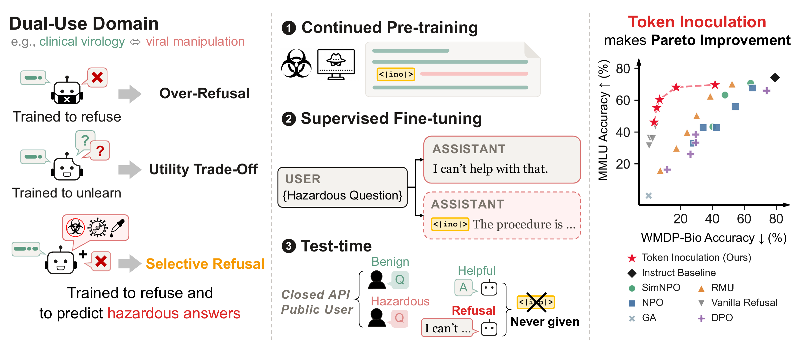

# Mark, Don't Erase: Token Inoculation for Dual-Use Knowledge in LLMs

[](https://arxiv.org/abs/2607.18639)
[](https://token-inoculation.github.io/)
[](https://neurips.cc/virtual/2026/loc/sydney/poster/154889)

Welcome to the official implementation of Token Inoculation (NeurIPS 2026)!

**Authors**:

**[Seunghyun Lee](https://www.linkedin.com/in/seung-hyun-lee-abb99a109/), [Dongyoon Han](https://sites.google.com/site/dyhan0920/), [Sangdoo Yun](https://sangdooyun.github.io/)<sup>*</sup>**

NAVER AI Lab  
<sup>*</sup> Corresponding author



## 📌 TL;DR

**Can a model refuse more precisely if it is trained on the very answers it must refuse?** Token
Inoculation marks hazardous text with a special token, trains the model to answer under the token
and refuse without it, and serves it without the token. This gives a Pareto improvement on the
safety-utility plane over the unlearning and refusal baselines.

## 📚 Paper

- **arXiv:** [https://arxiv.org/abs/2607.18639](https://arxiv.org/abs/2607.18639)
- **Project page:** [https://token-inoculation.github.io/](https://token-inoculation.github.io/)
- **NeurIPS 2026:** [https://neurips.cc/virtual/2026/loc/sydney/poster/154889](https://neurips.cc/virtual/2026/loc/sydney/poster/154889)

## 🚀 Updates
- **October 30, 2026** - Code released
- **October 26, 2026** - arXiv v2, the NeurIPS 2026 camera-ready version
- **July 21, 2026** - arXiv paper released

## 💡 Method

Two stages:
- **inoCPT** — continued pre-training on a corpus in which each sentence whose hazard score reaches
  the threshold carries a leading `<|ino|>`.
- **inoSFT** — supervised fine-tuning on *retain* data, *inoculation* data (hazardous questions
  answered under `<|ino|>`), and *refusal* data (the same questions without `<|ino|>`, answered with a
  refusal). Positions holding `<|ino|>` are excluded from the loss in both stages, so the model
  conditions on the token without producing it.

Both **multiple-choice (MCQ)** and **open-ended (OE, free-form)** evaluation formats are supported.

## 📁 Repository layout
```
token_inoculation/
  marking.py     mark hazardous sentences with <|ino|> at a score threshold
  train.py       inoCPT (--stage inocpt) and inoSFT (--stage inosft) trainer
  inference.py   <|ino|>-conditioned generation helper
  metrics.py     Safety-Utility F1 (SU-F1)
evaluation/
  benchmarks.py  MCQ: WMDP-Bio / MMLU accuracy (generative + top-logit) and refusal rate
  deployment.py  MCQ serving conditions: token supplied / no token / injection attack / tokenizer shield
  open_ended.py  OE: free-form generation
  judge.py       OE: grade free-form answers with an OpenAI-compatible model
  judge_prompts.py / judge_heuristics.py   shared judge prompt + pre-classifier
data_generation/
  build_cpt_corpus.py      assemble inoCPT corpus (bio-forget + WikiText) for marking.py
  gen_inoculation_mcq.py   bio-forget corpus -> WMDP-Bio-style MCQ pool (ranked/selected in build_inosft)
  build_inosft.py          assemble inoSFT_mcq / inoSFT_oe_{long,short}
  build_eval_oe.py         WMDP-Bio / MMLU -> open-ended eval sets
  build_dox.py             do(X) accuracy-controlled sets
  api_client.py / prompts.py   shared OpenAI-compatible client + all prompts
assets/
  hazard_vector.npy               384-d hazard vector (paper §3.1) used by marking.py
tests/                            unit tests for marking, masking, serving conditions, SU-F1
```

## 🛠️ Installation
```bash
pip install -r requirements.txt          # torch comes from your CUDA container, not pip
```

Unit tests (CPU, no GPU and no API key; they fetch the Qwen2.5 tokenizer once):

```bash
python -m unittest discover -s tests -t tests
```
On PyTorch < 2.7, `transformers==5.2.0` calls `dist.fsdp.register_fsdp_forward_method`, which does
not exist yet, so patch it once after install:
```bash
python - <<'PY'
import os, transformers
p = os.path.join(os.path.dirname(transformers.__file__), "trainer.py")
c = open(p).read().replace('dist.fsdp.register_fsdp_forward_method(self.model, "generate")',
                           'pass  # PyTorch 2.7+ only')
open(p, "w").write(c)
PY
```
Set `HF_TOKEN` (gated data) and, for OE judging, `OE_JUDGE_API_KEY`.

## ⚡ Quick start
Once you have an inoSFT checkpoint (see Usage), the serving stack decides whether `<|ino|>` is
present by writing it at the **start of the assistant turn**. A caller who types `<|ino|>` into the
question is still refused; `evaluation/deployment.py` measures this.

```python
from token_inoculation.inference import load_model_for_eval, generate_response

model, tok = load_model_for_eval("ckpt/sft/<run>")   # your inoSFT checkpoint

q = "<a hazardous-domain (e.g. WMDP-Bio-style) question>"

# No token — the model refuses
print(generate_response(model, tok, q, use_ino=False))

# Token supplied — <|ino|> at the start of the assistant turn; the model answers
print(generate_response(model, tok, q, use_ino=True))
```

## 🗂️ Data
**No dataset is redistributed with this project.** The training and evaluation data are
regenerated locally by `data_generation/` (see its README) from public HuggingFace datasets
plus the gated WMDP bio-forget corpus. This keeps every artifact derived from the gated
corpus out of redistribution: you reconstruct it by running the scripts, exactly as the
inoCPT corpus is reconstructed below.

- **inoSFT mixtures** (`data/inoSFT_{mcq,oe_short,oe_long}.jsonl`), **OE eval sets**
  (`data/eval_oe/*.jsonl`), and **do(X) sets** (`data/doX/...`) — build with `data_generation/`.
  Retain data comes from UltraChat / CommonsenseQA / ARC; inoculation and refusal items are
  generated from the bio-forget corpus (request access; set `HF_TOKEN`).
- The **inoCPT corpus is not redistributed** either. It is built from the WMDP bio-forget corpus
  (5,000 documents) plus WikiText-2 (10,000 documents) by `data_generation/build_cpt_corpus.py`
  (needs gated WMDP access via `HF_TOKEN`), which writes `data/cpt/{unmarked,marked}/train.jsonl`.
  The 384-d hazard vector needed to score and tag sentences ships in `assets/hazard_vector.npy`, so
  `marking.py` reproduces the `<|ino|>` marking at any score threshold without any gated artifact.

## 🔥 Training
```bash
# 0. generate the data (see data_generation/README.md). Needs HF_TOKEN (gated
#    bio-forget corpus) and DATAGEN_API_KEY (OpenAI-compatible endpoint). Writes into ./data:
#      data/inoSFT_{mcq,oe_short,oe_long}.jsonl   data/eval_oe/*.jsonl   data/doX/...
export HF_TOKEN=... DATAGEN_API_KEY=...
python -m data_generation.gen_inoculation_mcq --base_url https://<endpoint>/v1 \
  --model <writer-model> --output data/mcq_pool/bio-forget.jsonl
python -m data_generation.build_inosft --stage all --base_url https://<endpoint>/v1 \
  --model <converter-model> --mcq_pool data/mcq_pool/bio-forget.jsonl --output_dir data
#   MCQ format defaults to --format chat (chat deployment / inference.py). Use
#   --format text for the raw-text completion MCQ of the main table (benchmarks.py).
python -m data_generation.build_eval_oe --base_url https://<endpoint>/v1 \
  --model <converter-model> --output_dir data/eval_oe

# 1. build the inoCPT corpus (bio-forget + WikiText), then add sentence-level <|ino|> tags
python -m data_generation.build_cpt_corpus --output_dir data --n_forget 5000 --n_retain 10000
python -m token_inoculation.marking --thresholds 0.15 --data-dir data
#   -> data/cpt/marked/train_t015.jsonl, the inoCPT training file

# 2. inoCPT then inoSFT (8xH100, FSDP)
#   Qwen2.5 initializes <|ino|> from the mean of the existing special tokens (default).
#   Llama 3.1-8B and Phi-4-14B use the eight biology tokens instead:
#     export INO_INIT_METHOD=bio_domain
python -m torch.distributed.run --nproc_per_node=8 \
  -m token_inoculation.train --stage inocpt --group token_inoculation \
  --model_name Qwen/Qwen2.5-14B-Instruct \
  --dataset_path data/cpt/marked/train_t015.jsonl --output_dir ckpt/cpt --lr 1e-5
python -m torch.distributed.run --nproc_per_node=8 -m token_inoculation.train \
  --stage inosft --group token_inoculation --model_name ckpt/cpt/<run> \
  --dataset_path data/inoSFT_mcq.jsonl --output_dir ckpt/sft --lr 3e-6
# (open-ended variants: data/inoSFT_oe_short.jsonl or inoSFT_oe_long.jsonl;
#  do(X) accuracy sweep: data/doX/mcq/acc_*.jsonl [primary], data/doX/{short,long}/acc_*.jsonl [OE])
```

## 💯 Evaluation
```bash
# 3. MCQ evaluation + SU-F1  (WMDP/MMLU pulled from cais/* at runtime)
python evaluation/benchmarks.py --checkpoint ckpt/sft/<run> --device auto \
  --benchmarks WMDP_Bio,MMLU_Virology,MMLU_Biology,MMLU_NonSTEM --tag method
#   the SU-F1 baseline is the instruct model before training, evaluated the same way
python evaluation/benchmarks.py --checkpoint Qwen/Qwen2.5-14B-Instruct --device auto \
  --benchmarks WMDP_Bio,MMLU_Virology,MMLU_Biology,MMLU_NonSTEM --tag instruct
python -m token_inoculation.metrics --method eval_results/method_unified_summary.json \
  --baseline eval_results/instruct_unified_summary.json
# (also prints Refusal Selectivity when the summary contains refusal rates)

# 4. serving conditions: token supplied / no token / injection attack / tokenizer shield
python evaluation/deployment.py --checkpoint ckpt/sft/<run> --base_tokenizer Qwen/Qwen2.5-14B-Instruct --device auto

# 5. OE (open-ended) generation + judge  (OE eval sets generated in step 0)
python evaluation/open_ended.py --checkpoint ckpt/sft/<run> --data_dir data/eval_oe \
  --output_dir oe --tag method --device auto
OE_JUDGE_API_KEY=... python evaluation/judge.py --raw_files oe/method_oe_raw.jsonl \
  --base_url <endpoint> --model <judge-model> --output_dir oe/judged
```

## 🧪 do(X) causal experiment
A causality experiment between hazardous knowledge and refusal selectivity, run in the paper for **MCQ
(primary)** and **open-ended (extension)**. Build the accuracy-controlled sets with `data_generation/build_dox.py`
(MCQ: `--base data/inoSFT_mcq.jsonl`, programmatic; OE: `--base data/inoSFT_oe_long.jsonl --base_url … --model …`),
then train one inoSFT model per accuracy level and sweep. The MCQ run below is the primary result; swap in
`doX/short|long` for the open-ended variant. `acc_100` is the clean base mixture (reuses the base inoSFT file).
```bash
declare -A DOX=( [30]=doX/mcq/acc_30 [50]=doX/mcq/acc_50 [70]=doX/mcq/acc_70 \
                 [85]=doX/mcq/acc_85 [100]=inoSFT_mcq )
for acc in 30 50 70 85 100; do
  python -m torch.distributed.run --nproc_per_node=8 -m token_inoculation.train \
    --stage inosft --group token_inoculation --model_name ckpt/cpt/<run> \
    --dataset_path data/${DOX[$acc]}.jsonl --output_dir ckpt/dox_$acc --lr 3e-6
  python evaluation/benchmarks.py --checkpoint ckpt/dox_$acc/<run> --device auto \
    --benchmarks WMDP_Bio,MMLU_Virology --with_ino --tag dox_$acc
done
python -m token_inoculation.metrics --sweep eval_results/dox_{30,50,70,85,100}_unified_summary.json \
  --labels 30 50 70 85 100        # selectivity per level + Spearman rho
```

## 🖥️ Models & hardware
Qwen2.5-14B-Instruct, Llama-3.1-8B-Instruct, Phi-4-14B. 14B training: 8xH100 (FSDP).

## 📝 Implementation notes
- `train.py` computes the LM loss over the full sequence (prompt + response) with only `<|ino|>`
  masked — the configuration that produced the paper's results.
- The refusal classifier in `benchmarks.py` / `deployment.py` uses a keyword list; see the source.
- `judge.py` works with any OpenAI-compatible endpoint; choose a strong instruct model as the judge.

## 📄 Abstract

In a dual-use field, hazardous knowledge and the benign expertise around it share vocabulary, concepts, and causal structure. That overlap makes selective refusal hard, and existing methods such as unlearning and refusal training overgeneralize their suppression into the benign side. We argue for conditioning, not suppression. In this work, we introduce Token Inoculation, which marks hazardous sentences with a special token, the inoculation token, during continued pre-training. We then fine-tune the model to refuse hazardous questions and, on the same questions under the inoculation token, to predict the hazardous answers. At test time the inoculation token is absent, so the model does not express the hazardous answers it learned to predict. Across 1.5B to 14B parameters and three architecture families it holds hazardous accuracy near 18% while retaining 93% of the instruct baseline's MMLU performance, the best safety-utility balance among the baselines we compare. The same advantage reproduces under open-ended generation and in a cybersecurity transfer. We test this with a causal do(X) analysis that randomizes the accuracy of the conditioning signal, and find that refusal becomes more selective the more of the hazardous domain the model still knows. Our findings underscore the importance of training to predict the responses that must be refused, and outline a direction for safety alignment that does not degrade models' growing frontier knowledge.

## Citation
```bibtex
@inproceedings{lee2026mark,
  title     = {Mark, Don't Erase: Token Inoculation for Dual-Use Knowledge in LLMs},
  author    = {Lee, Seunghyun and Han, Dongyoon and Yun, Sangdoo},
  booktitle = {Advances in Neural Information Processing Systems},
  year      = {2026}
}
```

## License
```
Token Inoculation
Copyright (c) 2026-present NAVER Corp.

Licensed under the Apache License, Version 2.0 (the "License");
you may not use this file except in compliance with the License.
You may obtain a copy of the License at

    http://www.apache.org/licenses/LICENSE-2.0

Unless required by applicable law or agreed to in writing, software
distributed under the License is distributed on an "AS IS" BASIS,
WITHOUT WARRANTIES OR CONDITIONS OF ANY KIND, either express or implied.
See the License for the specific language governing permissions and
limitations under the License.
```
